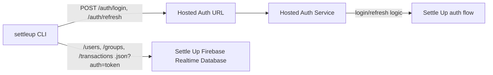

# Login And Auth Configuration

This page explains how the published `settleup` CLI signs in without shipping Firebase credentials.

## Sign in

Run `settleup auth login` in your terminal and enter your Settle Up email/password. The password is hidden while you type. The CLI does not support browser-based Google, Apple, or other provider login. If you use one of those methods, first [migrate your account to email/password](https://settleup.app/migrate-account).

The password is sent over HTTPS to the hosted auth service and is not saved by the CLI. User session tokens are stored locally; `settleup auth logout` removes that local session. On Unix, the session directory is mode 0700 and the file is mode 0600. This is file storage, not an OS keychain.

## Published Package Flow

Normal users of the published npm package do not need to configure auth or Firebase settings. The package uses the default production Settle Up database URL and the default hosted auth endpoint.

The CLI uses the hosted auth endpoint only for `/auth/login` and `/auth/refresh`. It uses the Settle Up Firebase Realtime Database URL for `.json` data paths such as `/users`, `/groups`, and `/transactions`.



In this flow, the published CLI does not need `SETTLEUP_FIREBASE_API_KEY`. The auth service owns that credential and returns only the session fields the CLI needs:

```json
{
  "accessToken": "<id-token>",
  "refreshToken": "<refresh-token>",
  "uid": "<firebase-uid>",
  "email": "user@example.com",
  "expiresAt": 1777872000000
}
```

## Staging Or Local Auth Flow

For staging, local development, or a trusted internal production run, a developer can skip the hosted auth endpoint and provide a Firebase Web API key locally.

Production with a local key:

```bash
SETTLEUP_ENV=production
SETTLEUP_API_BASE_URL=https://<prod-settle-up-realtime-database>
SETTLEUP_FIREBASE_API_KEY=<prod-firebase-web-api-key>
```

Staging with a local key:

```bash
SETTLEUP_ENV=staging
SETTLEUP_API_BASE_URL=https://<staging-settle-up-realtime-database>
SETTLEUP_FIREBASE_API_KEY=<staging-firebase-web-api-key>
```

When `SETTLEUP_FIREBASE_API_KEY` is present, the CLI signs in and refreshes directly through Firebase Auth. Database commands still use `SETTLEUP_API_BASE_URL`.

Do not publish or commit real Firebase keys. Keep them in local `.env` files, shell environment variables, or the hosted auth service configuration.

## Fallback Behavior

`SETTLEUP_AUTH_BASE_URL` is only needed for a custom hosted-auth setup. If it is not set and no Firebase key is provided, the CLI uses the packaged default auth endpoint when available, then falls back to `SETTLEUP_API_BASE_URL` for older deployments where auth and database proxying share one base URL.
