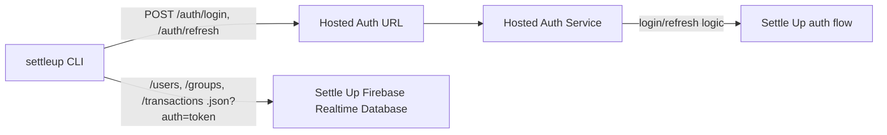

# Login And Auth Configuration

This page explains terminal and browser login without shipping the integration’s Firebase API key.

## Sign in

Run `settleup auth login` in your terminal and enter your Settle Up email/password. The password is hidden while you type. Browser login also uses email/password; it does not add Google, Apple, or other provider sign-in. If you use one of those methods, first [migrate your account to email/password](https://settleup.app/migrate-account).

The password is sent over HTTPS to the hosted auth service and is not saved by the CLI. Email, user ID, expiry, and session tokens use the OS credential store by default. Refresh uses the refresh token, never a saved password. `settleup auth logout` removes credentials for the selected configuration; it does not revoke copies held elsewhere.

## Browser login for agents

```sh
settleup auth login --browser
# Open the returned loginUrl privately and compare verificationCode.
# Enter email/password on the page, then finish in the same CLI environment:
settleup auth login --complete
settleup groups list
```

`--browser` returns a JSON object with `status: pending`, `loginUrl`, `verificationCode`, `expiresAt`, and `next`. A link lasts 10 minutes. The user's browser and the CLI can be on different computers. `--complete` returns `status: pending` until the page finishes; it saves the session when ready. `--complete --wait` polls every three seconds until ready or expired. `auth logout` clears the local pending login and requests remote cancellation.

The hosted login page is part of this independent community integration, not an official Settle Up sign-in page. Its same-origin Pages Function forwards the email/password to the existing auth Worker through an internal Cloudflare service binding. The Worker holds the Firebase API key and performs Firebase password verification. The key is never returned to the browser or bundled with the CLI. Refresh continues through the existing Worker.

The hosted services necessarily handle the password and readable session in memory during sign-in. The flow does not persist passwords, log credentials, or put them in URLs. The website backend encrypts only the required session fields for the CLI's temporary public key before storing a handoff. The browser receives only a completion status. A separate hashed poll credential allows the CLI to collect the encrypted session once; a browser link cannot collect it. Successful collection removes the encrypted handoff. Expired rows are inaccessible and are cleaned up on subsequent login requests. This does not make the CLI an official client or remove the need to trust the hosted service.

The CLI keeps its temporary private key and poll credential in a mode-0600 file under its mode-0700 environment directory on Unix. It removes that file on completion, logout, or the next start/completion after expiry. On Windows, protection relies on the containing directory's ACLs. Long-lived sessions use the configured OS credential store or explicit file storage. Neither passwords nor tokens are printed to stdout.

Custom environments or database/auth overrides must explicitly set `SETTLEUP_LOGIN_BASE_URL` to the matching website's HTTPS origin. HTTP loopback is allowed for local development. Unconfigured browser login fails instead of silently using production. See [deployment instructions](https://github.com/NewDae/settle-up-cli/blob/main/DEVELOPMENT.md#browser-login-website).

## Published Package Flow

Normal users of the published npm package do not need to configure auth or Firebase settings. The package uses the default production Settle Up database URL and the default hosted auth endpoint.

The CLI uses the hosted auth endpoint only for `/auth/login` and `/auth/refresh`. It uses the Settle Up Firebase Realtime Database URL for `.json` data paths such as `/users`, `/groups`, and `/transactions`.



In this flow, the published CLI does not need `SETTLEUP_FIREBASE_API_KEY`. The auth service owns that credential and returns only the session fields the CLI needs:

```json
{
  "accessToken": "<id-token>",
  "refreshToken": "<refresh-token>",
  "uid": "<firebase-uid>",
  "email": "user@example.com",
  "expiresAt": 1777872000000
}
```

## Configuration reference

| Variable | Meaning |
|---|---|
| `SETTLEUP_ENV` | Session namespace and default selection; default `production`. Use `staging` or `test` for separate environments. |
| `SETTLEUP_API_BASE_URL` | Optional database/API URL override. Production has a packaged default; non-production needs explicit configuration. |
| `SETTLEUP_AUTH_BASE_URL` | Optional hosted-auth URL override. |
| `SETTLEUP_FIREBASE_API_KEY` | Direct Firebase Auth key for local/staging/internal use; takes precedence over hosted auth when present. |
| `SETTLEUP_LOGIN_BASE_URL` | Browser-login website origin; production defaults to `https://settleupcli.pages.dev`. Required for custom/staging environments. |
| `SETTLEUP_CLI_CONFIG_DIR` | Optional session directory override; default `~/.config/settleup-cli`. The environment subdirectory remains separate. |
| `SETTLEUP_AUTH_STORAGE` | `keyring` by default; `file` explicitly opts into plaintext session storage. |

The CLI reads `.env` from its working directory; existing shell variables win. For test-runner env files, see [developer setup](https://github.com/NewDae/settle-up-cli/blob/main/DEVELOPMENT.md#environment-setup).

## Staging Or Local Auth Flow

For staging, local development, or a trusted internal production run, a developer can skip the hosted auth endpoint and provide a Firebase Web API key locally.

Production with a local key:

```bash
SETTLEUP_ENV=production
SETTLEUP_API_BASE_URL=https://<prod-settle-up-realtime-database>
SETTLEUP_FIREBASE_API_KEY=<prod-firebase-web-api-key>
```

Staging with a local key:

```bash
SETTLEUP_ENV=staging
SETTLEUP_API_BASE_URL=https://<staging-settle-up-realtime-database>
SETTLEUP_FIREBASE_API_KEY=<staging-firebase-web-api-key>
```

When `SETTLEUP_FIREBASE_API_KEY` is present, the CLI signs in and refreshes directly through Firebase Auth. Database commands still use `SETTLEUP_API_BASE_URL`.

Do not publish or commit real Firebase keys. Keep them in local `.env` files, shell environment variables, or the hosted auth service configuration.

## Automation and storage

Interactive login hides the password and sends prompts to stderr, keeping stdout JSON. Non-TTY login accepts email and password on separate stdin lines for controlled automation such as integration tests; it has no credential command-line flags. Agents should still ask the user to sign in privately rather than collect credentials.

The CLI checks expiry and refreshes before authenticated commands, including within the final minute before expiry. `auth status` reports the selected storage and local session presence; a successful read such as `groups list` confirms live access. Storage requirements and migration are described below.

## Fallback Behavior

`SETTLEUP_AUTH_BASE_URL` is only needed for a custom hosted-auth setup. If it is not set and no Firebase key is provided, the CLI uses the packaged default auth endpoint when available, then falls back to `SETTLEUP_API_BASE_URL` for older deployments where auth and database proxying share one base URL.

## Credential storage

`SETTLEUP_AUTH_STORAGE` defaults to `keyring`. The CLI uses macOS Keychain, Windows Credential Manager, or Linux Secret Service through `@napi-rs/keyring`. Linux requires a running session D-Bus and a persistent Secret Service provider such as GNOME Keyring or KWallet; the CLI does not fall back to the temporary kernel keyring or plaintext files.

A locked, unavailable, or inaccessible store returns `AUTH_STORAGE_FAILED` with recovery guidance. A stored session that cannot be parsed is treated as signed out; `settleup auth login` replaces it. `auth status` reports the selected `storage` without exposing tokens. Help and schema commands do not load the native module. `@napi-rs/keyring` ships prebuilt binaries for common macOS, Windows, and Linux targets; on a platform without one, use `SETTLEUP_AUTH_STORAGE=file`. Windows Credential Manager limits a stored session to 2560 bytes; a larger session returns `AUTH_STORAGE_FAILED` with the same file-mode guidance.

For an intentional plaintext session on a server or container, set `SETTLEUP_AUTH_STORAGE=file` for login and subsequent commands. Tokens are then saved under `~/.config/settleup-cli/<environment>/auth-<scope-hash>.json`, or the directory selected by `SETTLEUP_CLI_CONFIG_DIR`. Files are written atomically. On Unix, the `<environment>` directory is mode 0700 and session files are mode 0600; a newly created config directory is also 0700, but the CLI does not change the permissions of an existing one. Windows file access relies on the containing directory's Windows permissions; Unix modes do not establish Windows ACLs. Software running as your user can read plaintext sessions.

Sessions are scoped by the config directory, environment, database URL, and auth URL. Changing any of these selects a separate session. File and OS storage are separate choices; signing out in file mode does not remove an independently created OS-store session. Default OS logout also removes any file-mode copy for the same scope and the legacy file, preventing re-import.

On the first session read, an old `<config>/<environment>/auth.json` is imported into the selected store only when it has no session. The CLI reads back the saved session before deleting that old file. Failures preserve the old file and return an error. Legacy files have no backend identity, so import uses the currently selected environment and endpoints; choose the original settings when migrating a custom deployment. An existing session takes precedence over a stale legacy file. A successful fresh login also removes the legacy file after verifying storage.

Logout deletes local credentials; it does not revoke tokens already copied elsewhere. If a token is exposed, use the account provider's session revocation controls. OS storage protects saved secrets but cannot protect tokens inside a compromised CLI process.
