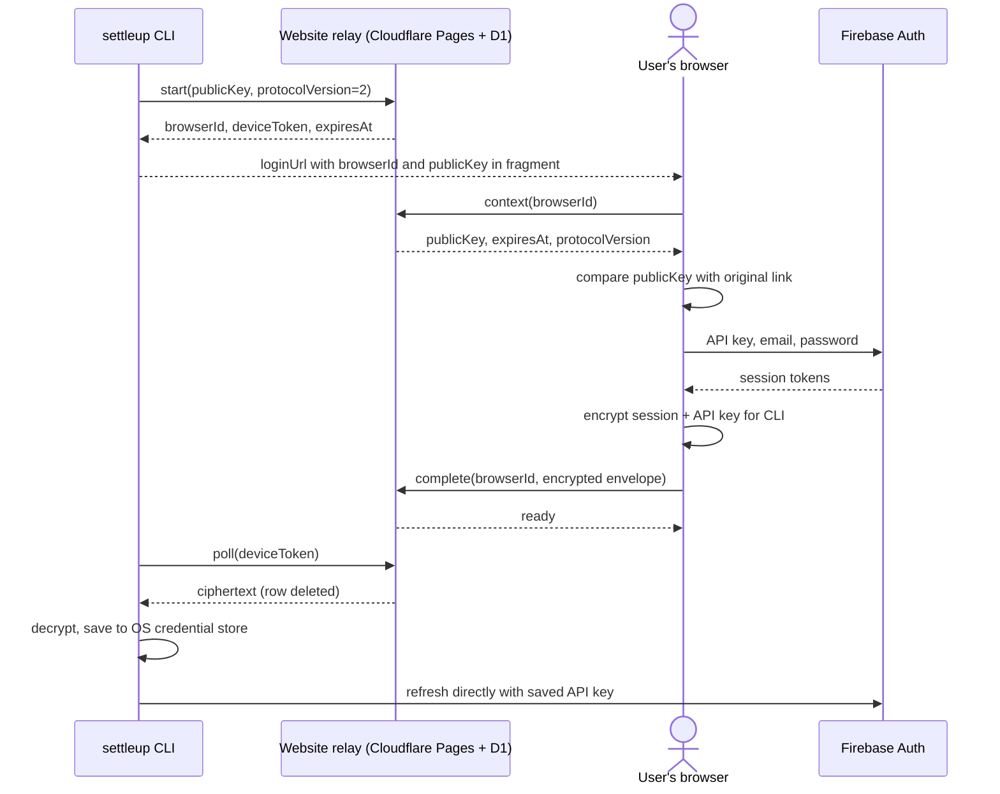

# Login And Auth Configuration

## Browser login for agents

Requires `settle-up-cli` **0.4.0 or newer**, a compatible Settle Up Firebase Web API key, and an email/password account. The key must belong to the Firebase project that authenticates your Settle Up account; a key from an unrelated project will not work. Users of Google, Apple, or another provider should first [migrate to email/password](https://settleup.app/migrate-account).

```sh
settleup auth login --browser
# Open loginUrl privately. Enter the Firebase API key, email, and password.
settleup auth login --complete
settleup groups list
```

The browser sends the API key and credentials **directly to Firebase Auth** over HTTPS. It encrypts the resulting session, including the key needed for refresh, before posting to the website backend. The backend is an encrypted handoff relay: it accepts no email, password, API key, or readable tokens, has no Firebase credentials, and does not call an auth Worker. The CLI decrypts the session and saves the supplied key alongside its tokens in the selected credential store. Subsequent refresh goes directly from the CLI to Firebase; the password is never saved or handed to the CLI.



`--browser` returns `status: pending`, `loginUrl`, `expiresAt`, and `next`. Links last 10 minutes; the browser and CLI can run on different computers. `--complete` returns `pending` until sign-in finishes; `--complete --wait` polls every three seconds. `auth logout` removes the saved session/key and cancels a pending handoff. It does not revoke copies elsewhere.

The key must allow Firebase Authentication sign-in and token refresh from the CLI; browser-only application restrictions can block CLI refresh. No key is bundled in npm or browser assets. The page holds credentials only in memory, clears the password after every attempt, and clears the key after success or expiry. The browser sees the Firebase response so it can encrypt it; only ciphertext is sent to our backend. The CLI reports the connected email, without printing the API key or tokens. Code: [browser verification](bin/lib/firebase-browser-login.mjs), [page controller](docs/login.js), [relay](server/browser-login.mjs), and [cryptography](bin/lib/browser-crypto.mjs).

### Browser login security model

| Concern | Protection |
|---|---|
| Password or API key sent to our backend | Only Firebase receives them. The relay accepts strictly an encrypted envelope and rejects credential/session fields. |
| Relay replaces the CLI encryption key | The public key is included in the original CLI link's fragment. The page checks the relay's context against that key before showing the form and encrypts to the original key. |
| Leaked link | The fragment is removed from the address bar and is not sent in normal HTTP navigation or referrers. A link cannot collect or decrypt the session; collection requires a separate 256-bit poll token stored only as a hash server-side. |
| Interception or tampering | P-256 ECDH, HKDF-SHA-256, and AES-256-GCM bind the ciphertext to the link ID. Collection is an atomic one-time delete. |
| Link phishing or someone signs in the wrong account | Only use a link you just asked your agent/CLI to create. Whoever created it gets that session. Confirm the email reported by the CLI. |
| Cross-site requests | Browser endpoints require same-origin `Origin`. CSP permits connections only to the site and Firebase's exact sign-in host, with no third-party scripts, framing, or referrers. |
| Abuse | Link creation retains its per-IP quota; Firebase controls sign-in/refresh rate limits and API-key restrictions. Our relay no longer handles or rate-limits password verification. Provider errors shown on the page are generic. |
| Public previews | Preview deployments use a separate handoff database. They have no auth Worker binding or server-side Firebase key. |
| Older clients/servers | Protocol version 2 requires CLI 0.4.0+. Mixed versions fail before signing in instead of silently falling back to hosted auth. |

This remains an independent community integration. Users trust the code their browser runs: a compromised host could serve modified JavaScript. Public source and direct Firebase requests make the intended flow inspectable; they do not prove a live deployment matches the source. Firebase Web API keys identify a project and are not user credentials, but their restrictions and quota matter ([Firebase guidance](https://firebase.google.com/docs/projects/api-keys)).

The temporary CLI private key and poll token remain in a mode-0600 file under its mode-0700 environment directory on Unix; Windows relies on directory ACLs. They are removed after completion, logout, or expired-login cleanup. Expired relay rows become inaccessible and are swept on subsequent requests. Malware running as the user can access local credentials. Changing the Settle Up password revokes Firebase refresh tokens; issued access tokens can remain valid until expiry.

### Self-hosting

Deploy `docs/`, the Pages Functions, and the D1 migration to your own Cloudflare account, then set `SETTLEUP_LOGIN_BASE_URL=https://<your-site>`. No auth Worker, service binding, or Firebase secret is needed for the relay. See [DEVELOPMENT.md](DEVELOPMENT.md#browser-login-website). Custom database/auth environments also require an explicit matching login origin; HTTP is allowed only for loopback development.

## Terminal login and legacy sessions

For direct terminal login, set `SETTLEUP_FIREBASE_API_KEY` locally and run `settleup auth login`. It reads email/password privately and sends them directly to Firebase. Browser login does not require the key in the CLI environment: enter it on the page instead.

For compatibility, existing terminal login without a local key and saved sessions without a key still use the legacy hosted `/auth/login` and `/auth/refresh` service. That separate service receives credentials/tokens; it is **not part of the new browser flow**. The source in `server/auth-worker/` is retained for those older clients. This PR does not shut down deployed Workers. To move a legacy session to the direct flow, sign out and sign in with browser login on CLI 0.4.0+.

## Configuration reference

| Variable | Meaning |
|---|---|
| `SETTLEUP_ENV` | Session namespace and defaults; `production` by default. |
| `SETTLEUP_API_BASE_URL` | Database/API URL override. Production has a packaged Settle Up database default; other environments require a URL. |
| `SETTLEUP_AUTH_BASE_URL` | Legacy hosted-auth override and session namespace. Not used to authenticate or refresh new browser sessions. |
| `SETTLEUP_FIREBASE_API_KEY` | Optional local key for direct terminal login and legacy-session refresh. New browser sessions use the key saved with that session. |
| `SETTLEUP_LOGIN_BASE_URL` | Browser relay origin; defaults to `https://settleupcli.pages.dev` for default production. Required for custom/staging environments. |
| `SETTLEUP_CLI_CONFIG_DIR` | Session directory override; defaults to `~/.config/settleup-cli`. |
| `SETTLEUP_AUTH_STORAGE` | `keyring` by default; `file` explicitly opts into plaintext tokens and key storage. |

The CLI reads `.env` from its working directory; existing shell variables win. Do not commit or log keys or session data. For test-runner env files, see [developer setup](DEVELOPMENT.md#environment-setup).

## Automation and storage

Terminal prompts go to stderr and hide the password; stdout stays JSON. Non-TTY terminal login accepts email and password on separate stdin lines for controlled integration tests, with a Firebase key configured in the environment if direct verification is required. Never ask users for keys, passwords, or tokens in chat. Agents should give them a private browser link.

The CLI refreshes before authenticated commands when expiry is within a minute. `auth status` reports local presence without the key or tokens; a successful read such as `groups list` confirms live access.

## Credential storage

`SETTLEUP_AUTH_STORAGE` defaults to `keyring`. The CLI uses macOS Keychain, Windows Credential Manager, or Linux Secret Service through `@napi-rs/keyring`. Linux requires a running session D-Bus and a persistent Secret Service provider such as GNOME Keyring or KWallet; the CLI does not fall back to the temporary kernel keyring or plaintext files.

A locked, unavailable, or inaccessible store returns `AUTH_STORAGE_FAILED` with recovery guidance. A stored session that cannot be parsed is treated as signed out; `settleup auth login` replaces it. `auth status` reports the selected `storage` without exposing tokens. Help and schema commands do not load the native module. `@napi-rs/keyring` ships prebuilt binaries for common macOS, Windows, and Linux targets; on a platform without one, use `SETTLEUP_AUTH_STORAGE=file`. Windows Credential Manager limits a stored session to 2560 bytes; a larger session returns `AUTH_STORAGE_FAILED` with the same file-mode guidance.

For an intentional plaintext session on a server or container, set `SETTLEUP_AUTH_STORAGE=file` for login and subsequent commands. Tokens are then saved under `~/.config/settleup-cli/<environment>/auth-<scope-hash>.json`, or the directory selected by `SETTLEUP_CLI_CONFIG_DIR`. Files are written atomically. On Unix, the `<environment>` directory is mode 0700 and session files are mode 0600; a newly created config directory is also 0700, but the CLI does not change the permissions of an existing one. Windows file access relies on the containing directory's Windows permissions; Unix modes do not establish Windows ACLs. Software running as your user can read plaintext sessions.

Sessions are scoped by the config directory, environment, database URL, and auth URL. Changing any of these selects a separate session. File and OS storage are separate choices; signing out in file mode does not remove an independently created OS-store session. Default OS logout also removes any file-mode copy for the same scope and the legacy file, preventing re-import.

On the first session read, an old `<config>/<environment>/auth.json` is imported into the selected store only when it has no session. The CLI reads back the saved session before deleting that old file. Failures preserve the old file and return an error. Legacy files have no backend identity, so import uses the currently selected environment and endpoints; choose the original settings when migrating a custom deployment. An existing session takes precedence over a stale legacy file. A successful fresh login also removes the legacy file after verifying storage.

Logout deletes local credentials; it does not revoke tokens already copied elsewhere. If a token is exposed, use the account provider's session revocation controls. OS storage protects saved secrets but cannot protect tokens inside a compromised CLI process.
