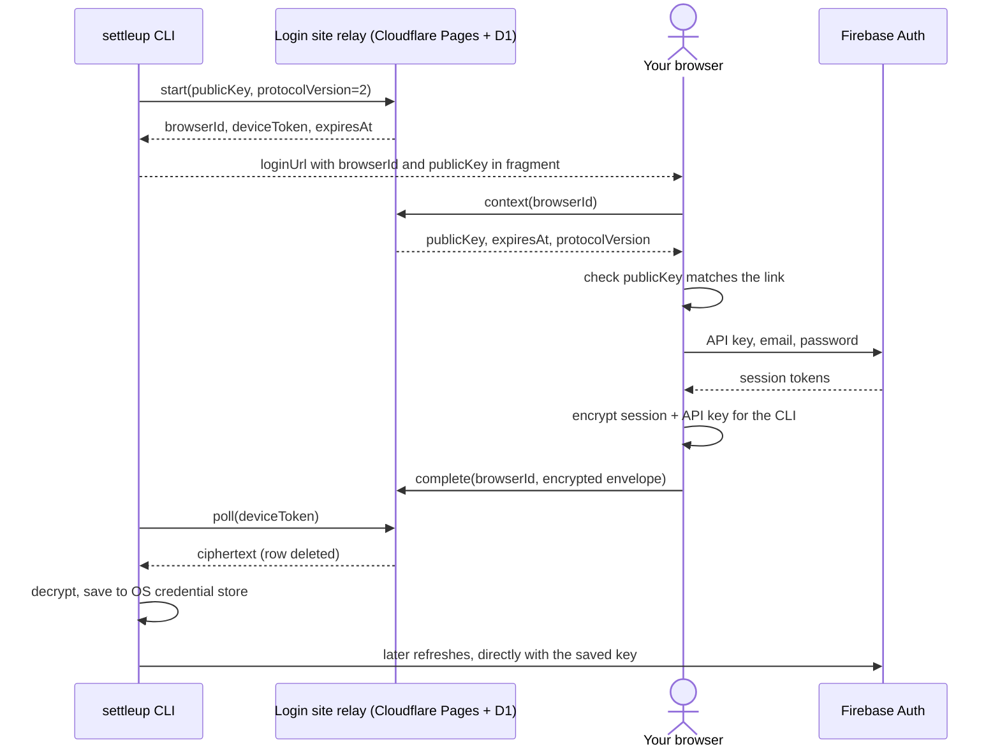

# Login And Auth Configuration

Settle Up CLI signs in with your Settle Up **email and password** plus the **Settle Up API key**. Your browser (or terminal) sends them straight to Firebase, Settle Up's sign-in provider. No server run by this project ever sees your password, key, or a readable session.

Requires `settle-up-cli` **0.4.0 or newer**. Google, Apple, and other sign-in methods aren't supported; [switch your account to email/password](https://settleup.app/migrate-account) first.

## Sign in

With an agent, ask it to connect your Settle Up account. It runs the first command and gives you a private link. Yourself:

```sh
settleup auth login --browser     # prints a private loginUrl
# Open loginUrl, enter your email, password, and the Settle Up API key.
settleup auth login --complete    # shows the connected email
settleup groups list
```

The link works for 10 minutes and can be opened on a different computer from the CLI. Only open a link you just asked for, and check the email the CLI reports afterwards.

Prefer the terminal? Run `settleup auth login`. It asks for the API key, email, and password (the password is hidden). To skip the key prompt, set `SETTLEUP_FIREBASE_API_KEY`.

The CLI saves the session and key in your OS credential store and renews the session automatically. `settleup auth logout` removes both.

## Finding the API key

The Settle Up API key is the public Firebase Web API key that Settle Up's own apps use to reach their sign-in service. It starts with `AIza` and is 39 characters long. It isn't a password and doesn't give access to anyone's account on its own, but keep it out of chat anyway so agents never handle sign-in material.

This CLI doesn't bundle the key. To find it yourself:

1. Open the Settle Up web app in a desktop browser and open its developer tools (**Network** tab).
2. Sign in to Settle Up.
3. Find the request to `identitytoolkit.googleapis.com`. The value after `key=` in its URL is the API key.

A key from any other Firebase project won't work; sign-in will fail with "check your email and password". You only need the key when signing in. The CLI keeps it with your session.

## How browser sign-in works



The login site's only backend is an encrypted handoff relay. It accepts no email, password, API key, or readable token, holds no Firebase credentials, and calls no other service. The page keeps your entries in memory only: it clears the password after every attempt and the key after success or expiry. The CLI never receives your password and never prints the key or tokens.

`--browser` returns `status: pending`, `loginUrl`, `expiresAt`, and `next`. `--complete` returns `pending` until you finish; `--complete --wait` polls every three seconds. Code: [browser sign-in](bin/lib/firebase-browser-login.mjs), [page controller](docs/login.js), [relay](server/browser-login.mjs), [cryptography](bin/lib/browser-crypto.mjs).

### Security model

| Concern | Protection |
|---|---|
| Password or key reaching our server | Only Firebase receives them. The relay accepts only a size-bounded encrypted envelope and rejects any other field. |
| Relay swapping the CLI's encryption key | The CLI's public key is in the link fragment. The page refuses to continue if the relay reports a different key, and always encrypts to the key from the link. |
| Leaked link | The fragment is removed from the address bar and never sent to servers or in referrers. A link can't collect or decrypt the session; that needs a separate 256-bit poll token stored only as a hash. |
| Interception or tampering | P-256 ECDH, HKDF-SHA-256, and AES-256-GCM, bound to the link ID. Collection is an atomic one-time delete. |
| Phishing, or signing in to the wrong account | Only use a link you just asked for: whoever created it receives the session. Check the email the CLI reports. |
| Cross-site requests | Relay endpoints require a same-origin `Origin`. The login page's CSP allows connections only to the site and `identitytoolkit.googleapis.com`, with no third-party scripts, framing, or referrers. |
| Abuse | Link creation has a per-IP quota using hashed IPs. Firebase enforces its own sign-in and refresh limits. Known Firebase error codes select fixed messages; raw provider responses are never shown, and a wrong email and wrong password share one message so accounts can't be probed. |
| Public previews | Preview deployments use a separate handoff database. |
| Mixed versions | Protocol version 2 requires CLI 0.4.0+. Mismatched versions stop before sign-in. |

This is an independent community project, not Settle Up itself. Your browser runs the JavaScript the login site serves; a compromised host could serve different code. The source is public so the flow can be inspected, but that doesn't prove what a live deployment serves. You can [self-host](#self-hosting) the site. Firebase Web API keys identify a project rather than a user ([Firebase guidance](https://firebase.google.com/docs/projects/api-keys)).

While a login is pending, the CLI's temporary private key and poll token sit in a mode-0600 file in a mode-0700 directory on Unix (Windows relies on directory ACLs) and are removed on completion, logout, or expiry. Expired relay rows become unusable and are purged on later requests. Malware running as your user can read local credentials. Changing your Settle Up password revokes refresh tokens; already-issued access tokens stay valid for up to an hour.

### Self-hosting

Deploy `docs/`, the Pages Functions, and the D1 migration to your own Cloudflare account, then set `SETTLEUP_LOGIN_BASE_URL=https://<your-site>`. The relay needs only its D1 database: no auth service or secrets. See [DEVELOPMENT.md](DEVELOPMENT.md#browser-login-website). Custom database environments also need an explicit login origin; plain HTTP is allowed only for loopback development.

## Upgrading from 0.3

CLI 0.3 and earlier signed in and refreshed through hosted auth endpoints, which were shut down on October 13, 2026. Those older CLIs can no longer sign in or renew sessions. Update with `npm install -g settle-up-cli@latest`, then sign in once with 0.4.0 or newer and the CLI stores the key for future renewals directly with Firebase. After upgrading, a saved 0.3 session keeps working until it next needs renewing (within an hour), then commands fail with `AUTH_REFRESH_FAILED` and ask you to sign in again. A login link from 0.3 won't work on the updated site: run `settleup auth logout`, update, and ask for a new link.

## Configuration reference

Normal use needs no configuration.

| Variable | Meaning |
|---|---|
| `SETTLEUP_ENV` | Session namespace and defaults; `production` by default. |
| `SETTLEUP_API_BASE_URL` | Database URL override. Production has a default; other environments require one. |
| `SETTLEUP_FIREBASE_API_KEY` | Optional. The Settle Up API key for terminal login, so you aren't prompted. Required for non-interactive terminal login. A key saved with a session takes precedence for renewal. |
| `SETTLEUP_LOGIN_BASE_URL` | Login site origin; defaults to `https://settleupcli.pages.dev` in default production. Required for custom/staging environments. |
| `SETTLEUP_CLI_CONFIG_DIR` | Session directory override; defaults to `~/.config/settleup-cli`. |
| `SETTLEUP_AUTH_STORAGE` | `keyring` by default; `file` explicitly opts into a plaintext session file (tokens and key). |
| `SETTLEUP_AUTH_BASE_URL` | Deprecated. No longer contacted; changing it only selects a separate session namespace. |

The CLI reads `.env` from its working directory; shell variables win. Don't commit or log keys or session data. For test-runner env files, see [developer setup](DEVELOPMENT.md#environment-setup).

## Automation and storage

Terminal prompts go to stderr and hide the password; stdout stays JSON. Non-interactive terminal login, for controlled integration tests, requires `SETTLEUP_FIREBASE_API_KEY` and reads email and password from separate stdin lines. Never ask users for keys, passwords, or tokens in chat. Agents should give them a private browser link.

The CLI refreshes before authenticated commands when expiry is within a minute. `auth status` reports local presence without the key or tokens; a successful read such as `groups list` confirms live access.

## Credential storage

`SETTLEUP_AUTH_STORAGE` defaults to `keyring`. The CLI uses macOS Keychain, Windows Credential Manager, or Linux Secret Service through `@napi-rs/keyring`. Linux requires a running session D-Bus and a persistent Secret Service provider such as GNOME Keyring or KWallet; the CLI does not fall back to the temporary kernel keyring or plaintext files.

A locked, unavailable, or inaccessible store returns `AUTH_STORAGE_FAILED` with recovery guidance. A stored session that cannot be parsed is treated as signed out; `settleup auth login` replaces it. `auth status` reports the selected `storage` without exposing tokens. Help and schema commands do not load the native module. `@napi-rs/keyring` ships prebuilt binaries for common macOS, Windows, and Linux targets; on a platform without one, use `SETTLEUP_AUTH_STORAGE=file`. Windows Credential Manager limits a stored session to 2560 bytes; a larger session returns `AUTH_STORAGE_FAILED` with the same file-mode guidance.

For an intentional plaintext session on a server or container, set `SETTLEUP_AUTH_STORAGE=file` for login and subsequent commands. Tokens are then saved under `~/.config/settleup-cli/<environment>/auth-<scope-hash>.json`, or the directory selected by `SETTLEUP_CLI_CONFIG_DIR`. Files are written atomically. On Unix, the `<environment>` directory is mode 0700 and session files are mode 0600; a newly created config directory is also 0700, but the CLI does not change the permissions of an existing one. Windows file access relies on the containing directory's Windows permissions; Unix modes do not establish Windows ACLs. Software running as your user can read plaintext sessions.

Sessions are scoped by the config directory, environment, database URL, and the deprecated `SETTLEUP_AUTH_BASE_URL`. Changing any of these selects a separate session. File and OS storage are separate choices; signing out in file mode does not remove an independently created OS-store session. Default OS logout also removes any file-mode copy for the same scope and the legacy file, preventing re-import.

On the first session read, an old `<config>/<environment>/auth.json` is imported into the selected store only when it has no session. The CLI reads back the saved session before deleting that old file. Failures preserve the old file and return an error. Legacy files have no backend identity, so import uses the currently selected environment and endpoints; choose the original settings when migrating a custom deployment. An existing session takes precedence over a stale legacy file. A successful fresh login also removes the legacy file after verifying storage.

Logout deletes local credentials; it does not revoke tokens already copied elsewhere. If a token is exposed, use the account provider's session revocation controls. OS storage protects saved secrets but cannot protect tokens inside a compromised CLI process.
