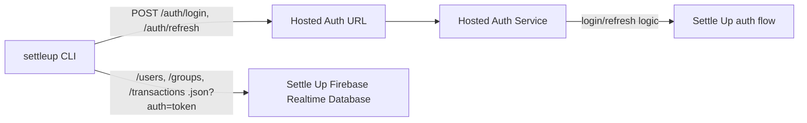

# Login And Auth Configuration

This page explains how the published `settleup` CLI signs in without shipping Firebase credentials.

## Sign in

Run `settleup auth login` in your terminal and enter your Settle Up email/password. The password is hidden while you type. The CLI does not support browser-based Google, Apple, or other provider login. If you use one of those methods, first [migrate your account to email/password](https://settleup.app/migrate-account).

The password is sent over HTTPS to the hosted auth service and is not saved by the CLI. User session tokens are stored in the OS credential store by default; `settleup auth logout` removes the session for the current configuration. Email, user ID, and expiry time are saved with the tokens. Refresh uses the refresh token, never a saved password.

## Published Package Flow

Normal users of the published npm package do not need to configure auth or Firebase settings. The package uses the default production Settle Up database URL and the default hosted auth endpoint.

The CLI uses the hosted auth endpoint only for `/auth/login` and `/auth/refresh`. It uses the Settle Up Firebase Realtime Database URL for `.json` data paths such as `/users`, `/groups`, and `/transactions`.



In this flow, the published CLI does not need `SETTLEUP_FIREBASE_API_KEY`. The auth service owns that credential and returns only the session fields the CLI needs:

```json
{
  "accessToken": "<id-token>",
  "refreshToken": "<refresh-token>",
  "uid": "<firebase-uid>",
  "email": "user@example.com",
  "expiresAt": 1777872000000
}
```

## Staging Or Local Auth Flow

For staging, local development, or a trusted internal production run, a developer can skip the hosted auth endpoint and provide a Firebase Web API key locally.

Production with a local key:

```bash
SETTLEUP_ENV=production
SETTLEUP_API_BASE_URL=https://<prod-settle-up-realtime-database>
SETTLEUP_FIREBASE_API_KEY=<prod-firebase-web-api-key>
```

Staging with a local key:

```bash
SETTLEUP_ENV=staging
SETTLEUP_API_BASE_URL=https://<staging-settle-up-realtime-database>
SETTLEUP_FIREBASE_API_KEY=<staging-firebase-web-api-key>
```

When `SETTLEUP_FIREBASE_API_KEY` is present, the CLI signs in and refreshes directly through Firebase Auth. Database commands still use `SETTLEUP_API_BASE_URL`.

Do not publish or commit real Firebase keys. Keep them in local `.env` files, shell environment variables, or the hosted auth service configuration.

## Fallback Behavior

`SETTLEUP_AUTH_BASE_URL` is only needed for a custom hosted-auth setup. If it is not set and no Firebase key is provided, the CLI uses the packaged default auth endpoint when available, then falls back to `SETTLEUP_API_BASE_URL` for older deployments where auth and database proxying share one base URL.

## Credential storage

`SETTLEUP_AUTH_STORAGE` defaults to `keyring`. The CLI uses macOS Keychain, Windows Credential Manager, or Linux Secret Service through `@napi-rs/keyring`. Linux requires a running session D-Bus and a persistent Secret Service provider such as GNOME Keyring or KWallet; the CLI does not fall back to the temporary kernel keyring or plaintext files.

A locked, unavailable, or inaccessible store returns `AUTH_STORAGE_FAILED` with recovery guidance. `auth status` reports the selected `storage` without exposing tokens. Help and schema commands do not load the native module.

For an intentional plaintext session on a server or container, set `SETTLEUP_AUTH_STORAGE=file` for login and subsequent commands. Tokens are then saved under `~/.config/settleup-cli/<environment>/auth-<scope-hash>.json`, or the directory selected by `SETTLEUP_CLI_CONFIG_DIR`. Files are written atomically. On Unix, config directories are mode 0700 and session files are mode 0600. Windows file access relies on the containing directory's Windows permissions; Unix modes do not establish Windows ACLs. Software running as your user can read plaintext sessions.

Sessions are scoped by the config directory, environment, database URL, and auth URL. Changing any of these selects a separate session. File and OS storage are separate choices; signing out in file mode does not remove an independently created OS-store session. Default OS logout also removes any file-mode copy for the same scope and the legacy file, preventing re-import.

On the first session read, an old `<config>/<environment>/auth.json` is imported into the selected store only when it has no session. The CLI reads back the saved session before deleting that old file. Failures preserve the old file and return an error. Legacy files have no backend identity, so import uses the currently selected environment and endpoints; choose the original settings when migrating a custom deployment. An existing session takes precedence over a stale legacy file. A successful fresh login also removes the legacy file after verifying storage.

Logout deletes local credentials; it does not revoke tokens already copied elsewhere. If a token is exposed, use the account provider's session revocation controls. OS storage protects saved secrets but cannot protect tokens inside a compromised CLI process.
